  

---

<h3 align="center">🔗 Connect with me</h3>

  
  
  
  

---

<h2 align="center">About me</h2>

  Hi, I'm a developer at <b>ECq Studio</b>, based in Bangkok, Thailand. 
  I build things for the web — sites, browser extensions, automation and Discord bots.

  <b>Web development</b> 
  <b>Browser extensions</b> 
  <b>Automation &amp; workflows</b> 
  <b>Discord bots</b>

---

<h2 align="center">Technologies</h2>

<h4 align="center">Core</h4>

  
  
  
  

<h4 align="center">Platforms &amp; tools</h4>

  
  
  
  
  

---

<h2 align="center">Featured project</h2>

  

---

<h2 align="center">Statistics</h2>

<table align="center">
  <tr>
    <td align="center"></td>
    <td align="center"></td>
  </tr>
</table>

---

<h3 align="center">⏱️ WakaTime · last 7 days</h3>

  

---

<h3 align="center">🔥 Contribution streak</h3>

  

---

<h3 align="center">📈 Contribution graph</h3>

  

  

  

